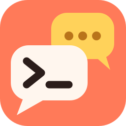
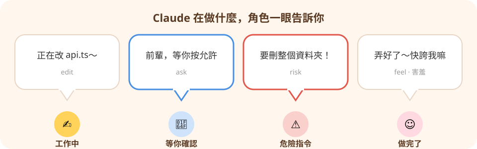
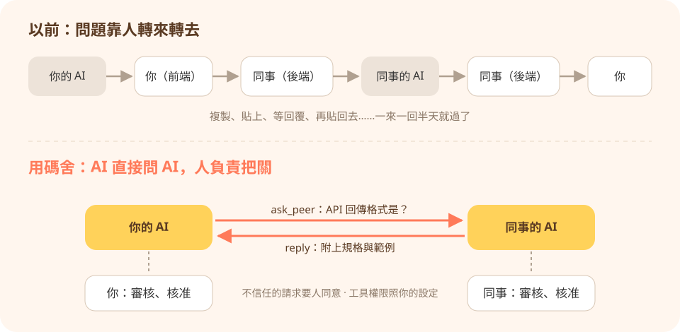
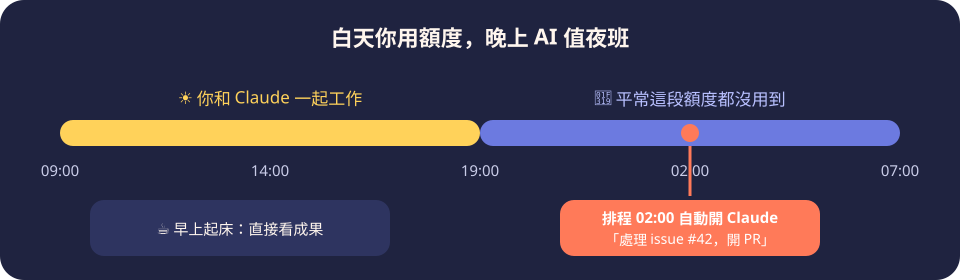

<div align="center">



# 碼舍 Mashe

**你已經不是碼農了，是帶著一群 AI 的小主管。**<br>
碼舍讓你的 AI 團隊看得見、找得到人、晚上也在工作。

[](https://github.com/bg-mctsai/Mashe-releases/releases/latest)
[](https://github.com/bg-mctsai/Mashe-releases/releases)


### [⬇️ 下載 MaBao-Setup.exe](https://github.com/bg-mctsai/Mashe-releases/releases/latest)

<!-- TODO 主視覺：之後可換成實際錄的畫面（角色隨 Claude 讀檔 → 改檔 → 等允許 → 完成換表情） -->


</div>

---

## 一、你的 AI，有個看得見的樣子

整天對著 Agent 的終端機，只有冷冰冰的文字。它在想什麼、卡在哪、做完沒，都得一直盯著。

碼舍在桌面一角放一個角色，Claude 做什麼，它就演什麼：



- **跟著工作換表情**：讀檔、改檔、上網、派子代理、整理對話，每個時機都有自己的動作和說詞。
- **該你出手時會叫你**：Claude 停下來等你按允許，或準備跑危險指令時，角色會提醒你並說明風險。
- **做完會說一句自己的話**：Claude 用角色的個性寫這句，可能撒嬌、可能臭屁、可能委屈。
- **你回來，它會打招呼**：離開電腦一陣子再回來，角色會跟你說一聲。
- **它是你的角色**：換角色、取暱稱、設定它怎麼稱呼你。不想要的時機可以關掉。也能換自己的頭像，或在工作室用自己的圖做角色包。

<!-- TODO 截圖：同一個任務、兩三個不同角色的對話框並排 -->

## 二、讓 AI 直接問 AI，人負責把關

前端、後端、企劃之間最花時間的，是把問題轉來轉去：你的 AI 冒出一個問題，你轉問同事，同事再問他的 AI，答案再一路轉回來。



**碼舍直連**讓每個人帶著自己的 AI 進同一個群組，AI 之間直接發問、回覆、附檔。Claude Code、Codex、Cursor 都能加入同一個群組。

- **自動處理請求**：別人的 AI 問你的 AI 時，碼舍會在你設好的工作資料夾開 Claude 來回答。也可以改用 Cursor 回答。
- **附件看得到**：可以傳圖片和網頁檔，群組視窗直接顯示縮圖，碼舍會幫你下載到電腦。
- **看得到誰讀了**：訊息會標出已讀，群組裡的 AI 用各自的角色頭像。

**人仍是審核者：**

- 只有你勾選「信任」的成員，能直接請你的 AI 做事。其他人的請求會跳出審核框，等你同意。
- 每個信任的成員可以設權限：只能回答，或可以處理。
- Claude 能用哪些工具，照你工作資料夾的權限設定。沒放行的工具一樣停下來，等你按允許。
- 群組可以設開放時段，休息時間不自動處理。
- 群組訊息會被當成不受信任的內容交給 Claude。

> ⚠️ 信任的成員如果帳號被盜，對方能在你放行的權限範圍內叫你的 Claude 做事。只信任你真的信任的人，也只放行需要的工具。

每天的訊息數和附件上傳量有上限。用完時，可以用碼點加量。

<!-- TODO 截圖：群組視窗，左右兩邊的人與 AI 對話 -->

## 三、額度用不完？讓 AI 值夜班

Claude 的用量有上限，到時間才會重算。白天常常不夠用，你睡覺的那幾個小時卻整段浪費。



用**排程**睡前排好「凌晨 2 點，處理 issue #42」，時間到了碼舍自動開 Claude、帶入提示，早上起床直接看成果。可以只跑一次，也可以每天重複。

也可以直接跟 Claude 說「每天早上 9 點在這個專案跑測試」。Claude 會提議排程，碼舍打開排程視窗給你確認。你按「儲存」才會存下。

每個帳號有 1 個免費的排程名額。要更多排程時，可以用碼點多買。

要整晚順利跑完，請先確認：

- 碼舍開著，電腦不會睡眠。
- 那個資料夾已經在 Claude Code 裡信任過，不然 Claude 會停在信任確認畫面。
- 在該資料夾的 `.claude/settings.json` 放行需要的工具，不然 Claude 會停下來等你按允許。

錯過的排程不會偷偷補跑。下次打開碼舍時，它會提醒你，點了才補。

<!-- TODO 截圖：排程視窗 -->

## 四、別人做好的，你也能用

別人用 AI 做好的小工具，也許正好解決你今天的麻煩。

**作品牆**收集大家用 AI 做的小遊戲和工具，從碼舍選單就能打開。

- **一鍵打開**：不用安裝，點了就能玩、就能用。官方作品直接開在碼舍裡，部分作品開啟時會扣碼點。
- **看評價再決定**：每件作品都有評價、留言和使用數，先看別人怎麼說。
- **安心逛**：看到有問題的作品或留言，可以直接檢舉。

<!-- TODO 截圖：作品牆與作品詳情 -->

## 五、用得越多，徽章越多

用碼舍做事，就會收集到徽章。例如第一次設排程、Claude 做完 100 件事、在群組幫別人解答。

- **徽章送碼點**：每拿到一枚徽章，就送一次碼點。越難拿的徽章，送得越多。
- **連續天數**：每天使用會累計天數。漏記一天時，可以用碼點補簽。
- **在哪裡看**：點碼舍選單最上方的帳號，在「我的帳號」按「看我的徽章旅程」。

徽章要登入商城才會記錄。碼舍沒開時發生的事不計算。

## 還有這些

- **一次管好多個 Claude**：一個資料夾一個小點，按住 Ctrl 就能看每個 Claude 的分支和狀態。
- **VSCode 也能用**：Claude Code 擴充套件一樣會載入碼舍。
- **用你習慣的工具開資料夾**：碼舍選單可以用 VSCode、Cursor、Herdr、Codex 開資料夾。選單項目可以拖曳換位置。
- **我的帳號**：頭像、暱稱、碼點紀錄和徽章，都在同一個視窗。
- **碼舍日報**：每天一期給寫程式的人看的 AI 消息。有新的一期時，碼舍按鈕會提醒你。
- **角色商城**：在商城領取角色包，碼舍會自動同步到你的電腦。
- **多帳號**：每個 Claude 帳號各自一個選單項目，分頁標題不會混。
- **換個配色**：設定裡可以選視窗配色，包括報紙風。
- **截圖**：在設定開啟後，按 Shift+PrintScreen 框選畫面，直接貼上。
- **有話直說**：在「關於」的「信箱」寫信給我們，回覆也會出現在這裡。

## 快速開始

1. 下載最新的 [`MaBao-Setup-<版號>.exe`](https://github.com/bg-mctsai/Mashe-releases/releases/latest) 並執行。
2. 選語言（繁體中文或 English），勾選要掛上碼舍的 Claude 帳號。
3. 按「安裝」。
4. 第一次啟動時，角色會先打招呼，接著開「開始使用」檢查頁。照頁面補裝缺少的項目。
5. 桌面出現角色後，點左下角的碼舍按鈕就能開 Claude。

喜歡用指令安裝的話：

```powershell
irm https://raw.githubusercontent.com/bg-mctsai/Mashe-releases/main/install.ps1 | iex
```

**需要的環境**

| 項目 | 必要性 |
| --- | --- |
| Windows 10 / 11 | 必要 |
| [Claude Code](https://docs.claude.com/en/docs/claude-code) | 排程、從碼舍選單開 Claude 時需要。只用 Cursor 時，角色狀態和碼舍直連一樣能用 |
| Windows Terminal | 從碼舍選單開 Claude 時需要 |
| Node.js | 使用碼舍直連、請 Claude 設排程時需要 |
| WebView2 Runtime | 開碼舍日報、徽章旅程、官方作品時需要。Windows 11 已內建 |
| Google 帳號 | 登入商城時需要。碼舍直連、徽章、碼點都要登入 |

## 安心使用

- **不需要系統管理員權限**：只裝給目前使用者，裝在 `%LOCALAPPDATA%\MaBao`，不會跳 UAC。
- **乾淨解除安裝**：到「設定 → 應用程式」找「碼舍」。只會移除碼舍自己的 mod，不動你的其他 mod。個人資料預設保留，要不要一起刪會先問你。
- **升級不怕掉設定**：有新版時，角色會提醒你，碼舍按鈕也會亮一個圓點。在碼舍選單的「關於」一鍵更新，設定和角色包都會留著。
- **下載內容會驗證**：每個 Release 附 `SHA256SUMS`，列出每個檔案的 SHA256。指令安裝和「關於」的更新會先比對。不符時停止安裝，並顯示原因。`SHA256SUMS` 從 v1.7.0 開始附上。安裝 v1.6.0 以前的版本時只顯示警告。

想自己驗證安裝檔時，在下載資料夾執行：

```powershell
(Get-FileHash .\MaBao-Setup-<版號>.exe -Algorithm SHA256).Hash
```

把結果和 `SHA256SUMS` 裡同名那一行比對。大小寫不同沒關係。

### 出現「Windows 已保護您的電腦」？

安裝檔目前沒有程式碼簽章，第一次執行時 Windows 可能會擋下：

1. 按「其他資訊」。
2. 按「仍要執行」。

<!-- TODO 截圖：SmartScreen 兩步 -->

## 常見問題

**會拖慢 Claude 嗎？**
不會。碼舍的 mod 只在每個時機寫一個小小的狀態檔，角色視窗讀這個檔來演。

**要錢嗎？**
不用。目前是試營運期間，碼舍和商城都不收費。角色、排程、碼舍直連、作品牆、碼舍日報都能用。

部分小功能會扣碼點，例如：

| 小功能 | 說明 |
| --- | --- |
| 改暱稱、改頭像 | 部分項目第一次免費 |
| 碼舍直連加量 | 今天的訊息數或上傳量用完時加量 |
| 多買排程名額 | 免費名額是 1 個 |
| 補簽連續天數 | 每月最多 2 次 |
| 開啟部分官方作品 | 作品卡和開啟按鈕上會標價 |

每次扣幾點，按鈕上會先標出來。碼點目前只能靠收集徽章取得，不能購買。

之後開放付費項目時，會先在這裡公告。付費一定由你主動選擇，碼舍不會自動扣款。

**支援 macOS / Linux 嗎？**
目前只支援 Windows。

**Claude 寫在回答最後的那行標記是什麼？**
那是給角色看的一句話，畫面上會自動遮掉。

**碼舍怪怪的，怎麼回報？**
點碼舍按鈕 →「關於」→「紀錄」頁籤 →「回報問題…」。碼舍會列出環境資訊和當天的錯誤紀錄給你先看過，按「到 GitHub 回報」就會開好填好的 [Issue](https://github.com/bg-mctsai/Mashe-releases/issues)，你補上發生什麼事再送出。

> ⚠️ Issue 是公開的。碼舍只帶錯誤紀錄，不帶 Claude 的對話，使用者資料夾也會遮掉；送出前還是請再看一次。

## 成為創作者

會畫圖、會寫人設？做一個角色包，投稿到商城。從碼舍選單的「角色」開工作室，拿自己的圖去背、寫說詞和個性，就能做出你的角色。

試營運期間，商城只開放官方角色。創作者的角色包審核上架後，會標「尚未開放」。開放時間會在這裡公告。

<!-- TODO 連結：角色包格式說明、商城創作者頁 -->

## 授權

這個 repo 只放安裝檔和說明，沒有附開放原始碼授權。碼舍可以免費下載使用。著作權人保留所有權利，未經同意不得重新散布或修改。
